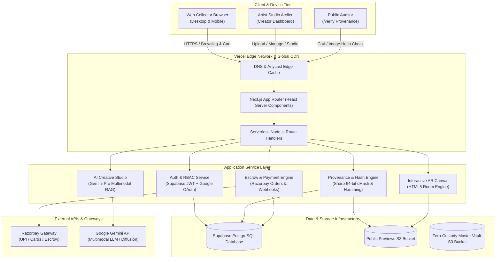
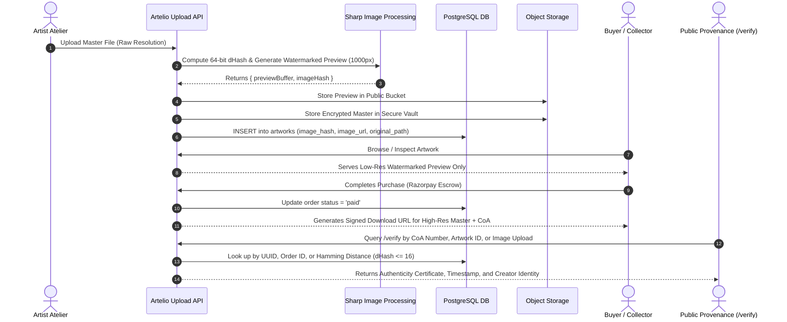
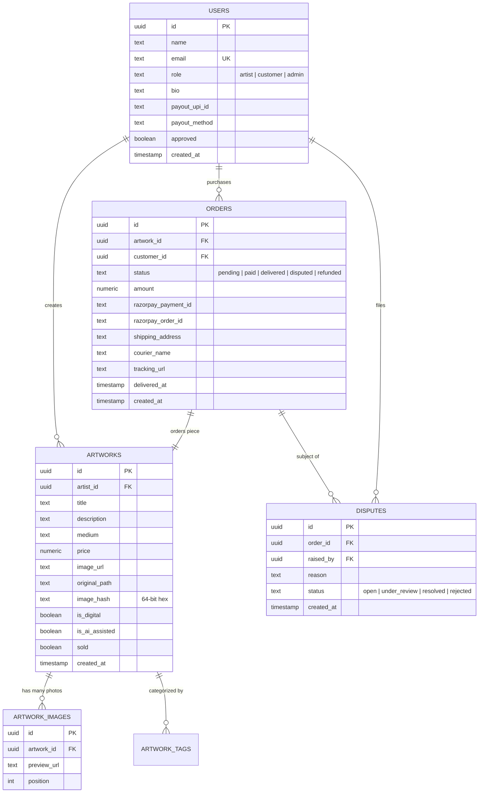
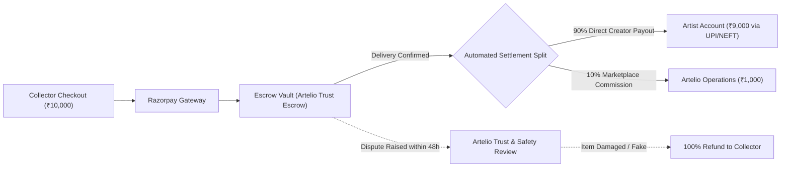

# Artelio Marketplace – Full Technical & System Architecture Document

> **System Designation:** AI-Enabled Zero-Custody Marketplace for Fine Art & Independent Creators  
> **Repository:** `bhosalegurudatta-ind/artelio-marketplace`  
> **Production URL:** `https://artelio-marketplace.vercel.app`  
> **Architecture Version:** 2.4.0 (Production Edition)  
> **Last Updated:** November 2026  

---

## 1. Executive Summary & Design Philosophy

Artelio is a modern fine art and creative lifestyle marketplace engineered to empower independent artists while providing art collectors with museum-grade trust, authenticity guarantees, and interactive visual technologies.

### Core Architectural Pillars
1. **Zero-Custody Master Storage:** The platform never takes unconditional custody of unwatermarked, high-resolution original art files. Only downsampled, watermarked previews are indexed publicly; master resolution files are stored securely in creator vaults and released only upon confirmed payment.
2. **Cryptographic Provenance (dHash):** Every artwork is fingerprinted with a 64-bit perceptual difference hash (`dHash`), logged immutably alongside artist identity and creation timestamps, enabling instant public authenticity verification and duplicate detection.
3. **Multimodal AI Style-Fusion (RAG-Assisted):** Artists can leverage Google Gemini multimodal models grounded in their own existing portfolio references to generate novel artwork variations and concept art while retaining their signature artistic style.
4. **Automated Escrow & 90/10 Fair Split:** Financial transactions are split into a 90% creator payout and a 10% platform fee, protected by a milestone-based escrow hold released upon verified physical/digital delivery.
5. **Interactive AR Room Visualizer:** Real-time canvas projection enabling collectors to preview art on customizable living room, bedroom, and studio walls with real-world dimensions and bespoke framing styles.

---

## 2. High-Level System Architecture

The following diagram illustrates the end-to-end data flow between collectors, artists, the Next.js application layer, external cloud microservices, and database stores:



---

## 3. Technology Stack & Layer Breakdown

| Layer | Technologies Selected | Rationale & Architectural Purpose |
| :--- | :--- | :--- |
| **Frontend Framework** | Next.js 14 (App Router), React 18, TypeScript | Full-stack hybrid SSR + CSR architecture with optimal Core Web Vitals, static page generation, and SEO optimization. |
| **Styling & Design System** | Tailwind CSS 3.4, PostCSS, Lucide Icons | Utility-first styling adhering strictly to the Artelio Brand Palette (`#F83758` Coral Red, `#17223B` Deep Navy, `#FAF9F6` Warm Linen). |
| **Backend & APIs** | Next.js Serverless Route Handlers (`runtime = 'nodejs'`) | Lightweight, autoscaling microservices handling multipart uploads, webhook validation, and payment coordination. |
| **Image & Media Engine** | Sharp (libvips C-bindings) | High-speed server-side image processing, 64-bit perceptual hashing, tiled SVG watermark generation, and downscaling. |
| **Database & Auth** | Supabase (PostgreSQL 15), Supabase Auth (JWT), Row-Level Security (RLS) | Relational integrity, foreign key cascades, role-based access control, and Google OAuth 2.0 social sign-in. |
| **Object Storage** | Supabase Storage (S3-compatible) | Dual-bucket configuration separating public watermarked previews (`artworks`) from secure master releases (`originals`). |
| **AI & Multimodal Vision** | Google Gemini Multimodal API (`@google/genai`) | Contextual style extraction, multimodal prompts referencing existing portfolio pieces, and curatorial suggestions. |
| **Payment Gateway** | Razorpay Node SDK & Razorpay Standard Checkout | Live UPI, NetBanking, Cards, and recurring Subscriptions with cryptographic signature validation (`hmac-sha256`). |
| **Hosting & CI/CD** | Vercel Edge Platform + GitHub Actions | Automated continuous deployment on pushes to `main`, instant edge caching, and SSL termination. |

---

## 4. Zero-Custody & Cryptographic Provenance Architecture

Artelio solves the single greatest vulnerability of online digital art marketplaces: **the risk of unauthorized replication and theft of master resolution assets.**



### 4.1 Perceptual Difference Hashing (`dHash`) Algorithm
Unlike cryptographic hashes (SHA-256 or MD5) which change drastically with even a single bit flip, Artelio computes a **64-bit Difference Hash (dHash)**:
1. The input image is converted to grayscale and stripped of alpha channels.
2. The image is resized to an exact $9 \times 8$ grid ($72$ total pixels).
3. Adjacent horizontal pixels are compared: if pixel $(x, y) > (x+1, y)$, bit is `1`, else `0`.
4. The resulting 64-bit string is encoded as a 16-character hexadecimal string.
5. Verification computes the **Hamming Distance** (count of differing bits). A distance $\le 16$ indicates a confident visual match regardless of compression or minor scaling.

---

## 5. Database Schema & Data Models

The relational schema is hosted on Supabase PostgreSQL and enforces strict referential integrity.



---

## 6. Financial, Escrow & Subscription Architecture

Artelio adopts a compliant, transparent financial model structured around direct creator empowerment.



### 6.1 Subscription Tiers (ES Course Report Sec 5.1)
- **Artist Professional Subscription (₹999 / month or ₹9,990 / year):**
  - Unlimited artwork listings with automated zero-custody watermarking.
  - 64-bit dHash provenance registration on the public ledger.
  - Multimodal AI Studio access (portfolio style-fusion).
  - Payout processing at 90% net rate.
- **Collector VIP Membership (₹499 / month):**
  - Unlimited 3D Room Visualizer wall previews & high-res exports.
  - Early-access drops (48 hours before general release).
  - Private 3D virtual spaces and curated collection galleries.

---

## 7. Security, Authentication & Role-Based Access Control (RBAC)

Artelio enforces defense-in-depth across the entire request lifecycle:

1. **Authentication:**
   - Supabase Auth handles user sessions via asymmetric JWT tokens.
   - Google OAuth 2.0 social sign-in synchronizes directly to the internal `users` schema via server-side `/api/auth/sync`.
2. **Authorization Roles:**
   - `visitor`: Unauthenticated public users (read-only browsing, public provenance lookup).
   - `customer`: Verified buyers (can purchase, bookmark, message artists, file disputes).
   - `artist`: Verified creators (can access upload atelier, set UPI payout details, run AI studio).
   - `admin`: Platform governance (can resolve disputes, hide flagged content, verify creator applications).
3. **Server-Side Guard Rails:**
   - Critical API routes (`/api/admin/*`, `/api/artworks/delete`) verify user identity using `supabaseAdmin` service role credentials against database records, completely immune to client-side header tampering.

---

## 8. Directory & Codebase Architecture

```text
artelio-marketplace/
├── app/
│   ├── api/
│   │   ├── admin/           # Admin dispute & artist moderation endpoints
│   │   ├── ai/              # Gemini multimodal RAG & prompt generation
│   │   ├── artworks/        # Artwork CRUD & watermarking handlers
│   │   ├── orders/          # Escrow order management & tracking
│   │   ├── razorpay/        # Payment order creation & webhook verification
│   │   ├── subscriptions/   # Razorpay recurring subscription APIs
│   │   └── verify/          # Public provenance registry & dHash matching
│   ├── artwork/[id]/        # Artwork detail page & AR visualizer modal
│   ├── browse/              # Filterable, searchable art gallery
│   ├── checkout/            # Razorpay secure checkout flow
│   ├── dashboard/           # Artist atelier (Upload, AI Studio, Billing)
│   ├── orders/              # Collector order tracking & dispute initiation
│   ├── plans/               # Subscription upgrade portal (₹999 / ₹499)
│   ├── spaces/              # 3D private virtual gallery & wall visualizer
│   └── verify/              # Public provenance authenticity portal
├── components/              # Reusable React components (Navbar, Modals, Cards)
├── lib/                     # Core business logic (imageTools, plans, supabase)
├── public/                  # Static assets, branding, and local artwork catalog
├── scripts/                 # Maintenance utilities (backfill-hashes.js)
├── ARCHITECTURE.md          # Technical architecture document
└── tailwind.config.ts       # Design system tokens and styling rules
```

---

## 9. Verification & Quality Assurance Protocols

1. **Continuous Integration:** Every commit to `main` undergoes full static type checking (`npx tsc --noEmit`) prior to production deployment.
2. **Automated Provenance Audit:** Previews are verified against the perceptual hash ledger with Hamming distance assertions before being marked active.
3. **Payment Integrity:** Webhook signatures are verified with cryptographically secure HMAC-SHA256 tokens using the dedicated Razorpay secret.
